# Sun Power Solar: Solar Installation Management System

One connected system for a rooftop-solar company, from the first website enquiry to the director's month-end report.
A website captures the lead, an AI advisor calls the customer, and the team handles the survey, quotation, warehouse
dispatch, installation and after-sales service in one CRM. The customer gets their own login with digital warranty cards.

> **Status:** working prototype, tested end to end on a live Supabase project (150+ automated checks across all roles).

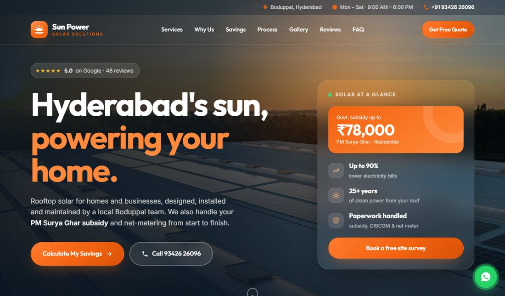

---

## Contents
- [What it does](#what-it-does)
- [Who uses it](#who-uses-it)
- [How it fits together](#how-it-fits-together)
- [Features](#features)
- [Screenshots](#screenshots)
- [Tech stack](#tech-stack)
- [Project structure](#project-structure)
- [Setup](#setup)
- [Run it locally](#run-it-locally)
- [Demo walkthrough](#demo-walkthrough)
- [Security](#security)

---

## What it does

The system follows one customer through six stages:

| # | Stage | What happens |
|---|---|---|
| 1 | **Rooftop inquiry** | The customer fills the website form. An AI advisor (Bolna) calls them, Gemini writes the call minutes, and WhatsApp follows up with an estimate and a survey booking. |
| 2 | **Getting the kit right** | The site engineer records the roof survey on a phone. The office approves it and builds the final quotation from a kit template, with GST and the PM Surya Ghar subsidy. The customer accepts on WhatsApp. |
| 3 | **Dispatch & serial numbers** | The advance payment confirms the order. Stock is reserved and a crew is booked automatically. The warehouse scans every serial number before dispatch. |
| 4 | **On the roof** | The technician completes safety checks, scans panel serials, takes the required photos, confirms the size and gets the customer's signature. The office issues the GST invoice, sees profit per job and takes the final payment. |
| ★ | **Handover: Localhost users** | When the order is fully paid, the customer automatically gets a login with warranty cards per unit, the installation record, documents, subsidy progress and service requests. |
| 5 | **Rainy-season breakdown** | The customer reports a problem. The ticket gets a deadline, and the unit's own warranty decides free or charged. A technician visits, and the ticket closes only when the customer confirms the fix. |
| 6 | **Director's month-end** | Sales, cash, margin, installations, service quality, technician pay and subsidy, for today, this week or the month. |

---

## Who uses it

Everyone uses the same CRM address and sees only the screens for their role.

| Role | Device | What they do |
|---|---|---|
| **Customer** | Phone | Website enquiry, WhatsApp updates, their own login (Localhost users) |
| **Owner / manager** | Laptop | Everything, including the director dashboard, team pay and invoice cancellation |
| **Office staff** | Laptop | Leads, quotations, orders, payments, invoices, service desk, subsidy |
| **Site engineer** | Phone | Site surveys with photos |
| **Warehouse** | Laptop / phone | Packing, serial scanning, dispatch |
| **Technician** | Phone | Installations and service visits |
| **Automatic** | none | AI calls (Bolna), call minutes (Gemini), WhatsApp messages (Twilio) |

---

## How it fits together

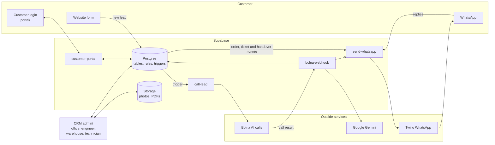

- The **database does the work**: status changes, stock reservation, crew booking, warranty dates, invoice numbers and the rules
  below all live in Postgres functions and triggers, so they hold no matter which screen is used.
- **Edge Functions** talk to the outside services and keep every secret on the server.
- The **CRM and customer pages are plain HTML, CSS and JavaScript**: no framework and no build step.

---

## Features

**Leads & AI calling**
- Website form with consent. The AI advisor calls within calling hours (Monday to Saturday, 9 am to 7 pm IST).
- Gemini call minutes: summary, requirements, customer needs, next steps.
- A lead's stage only moves forward. Leads can also come from phone calls, walk-ins and (optionally) WhatsApp.

**Survey & quotation**
- Engineer's mobile survey with photos. The manager approves it; an engineer can't approve their own.
- Kit templates: 1–5 kW on-grid, off-grid and hybrid systems, plus panel-only sets. Quantities scale with size and surveyed cable lengths.
- Estimate and final quotation PDFs, GST per item, the PM Surya Ghar subsidy, acceptance on WhatsApp.

**Orders, warehouse & schedule**
- The advance payment confirms the order: stock is reserved, a packing list is created, and the next free crew is booked.
- Receipts as PDF and a UPI QR code for payment.
- Serial scanning by camera or keyboard. **Dispatch stays locked until every serial is scanned.** Then the vehicle and driver are recorded and a delivery note is printed.
- A crew calendar with rescheduling and overbooking warnings.

**Installation**
- **Six safety checks before work can start**, enforced by the database too.
- An 8-point checklist, panel serials scanned on the roof, required photo types, installed size (differences are flagged), generation reading and the customer's signature.
- Each unit's warranty starts on delivery. A completion certificate PDF is made.

**Money**
- GST tax invoices: one numbering series per financial year, CGST/SGST or IGST, no edits after issue, cancellation by a manager only.
- Job costs and **profit per job**. Stock purchases at weighted-average cost.
- A subsidy tracker per application. Technician hours are logged automatically from jobs, with pay per month.

**Service**
- Find a customer in seconds by serial number, phone, client ID or name, with each unit's warranty status.
- Tickets with priority and response deadlines. The exact unit's warranty decides free or chargeable.
- Technician visit form: cause, work done, parts from stock, before and after photos, signature.
- Chargeable repairs get an automatic invoice (parts + visit fee + GST).
- A ticket closes only after the customer confirms the fix. There is also a pre-monsoon checkup campaign.

**Customer login (Localhost users)**
- Created automatically when an order is completed, and sent once on WhatsApp. The customer must set their own password at first sign-in.
- Warranty cards per unit with serial numbers and time left, the installation record with photos, subsidy progress, invoices and receipts, service requests with ratings, a QR code, and a one-page **warranty card PDF**.
- The office can send a new password (shown once). Five wrong passwords lock the login for 15 minutes.

**Director dashboard**
- Today / this week / month headline figures, compared with the previous period.
- Sales funnel, leads by source, trends, profit per job, purchases, a month-end PDF report and a CSV export.

---

## Screenshots

| | |
|---|---|
| 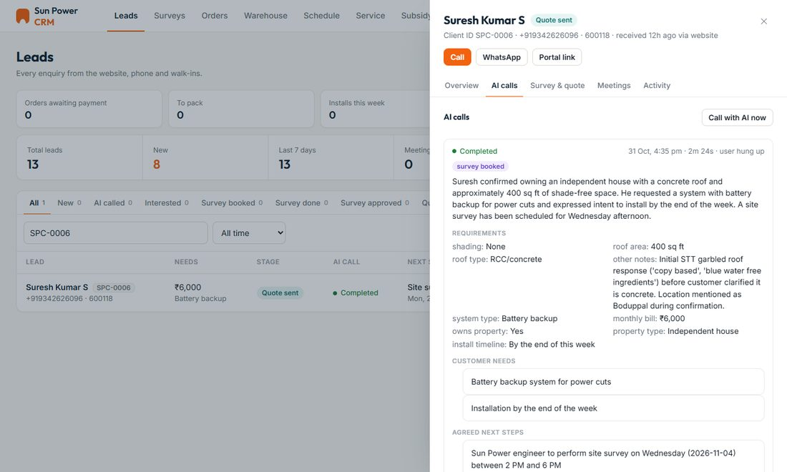 **AI call with Gemini minutes** | 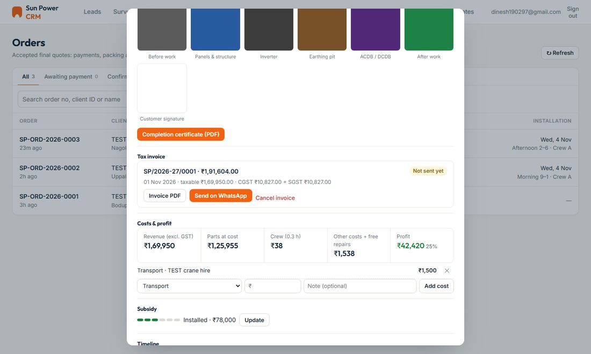 **Order: photos, invoice, profit** |
| 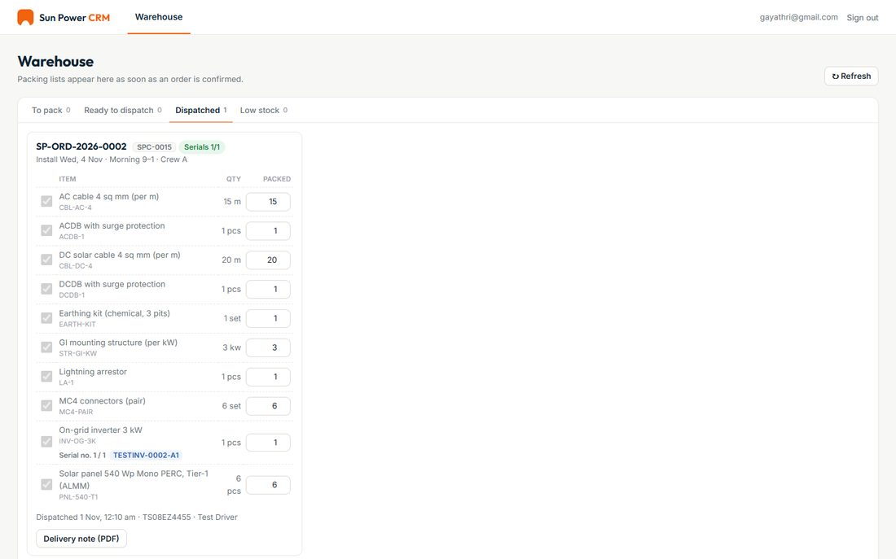 **Warehouse dispatch with serials** | 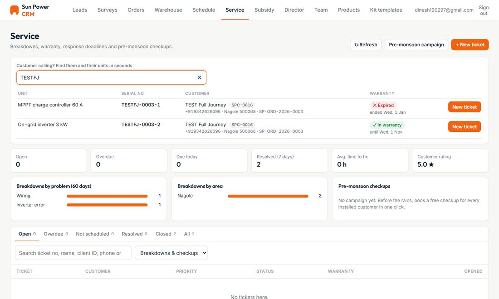 **Service: find a unit, see its warranty** |
| 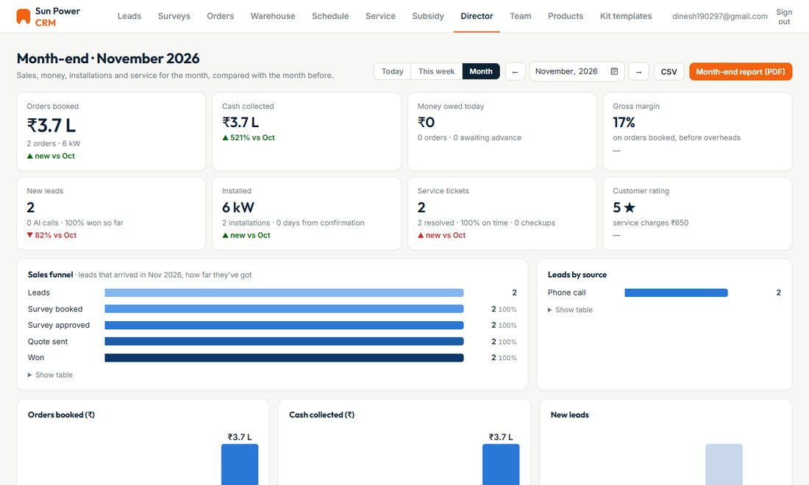 **Director dashboard** | 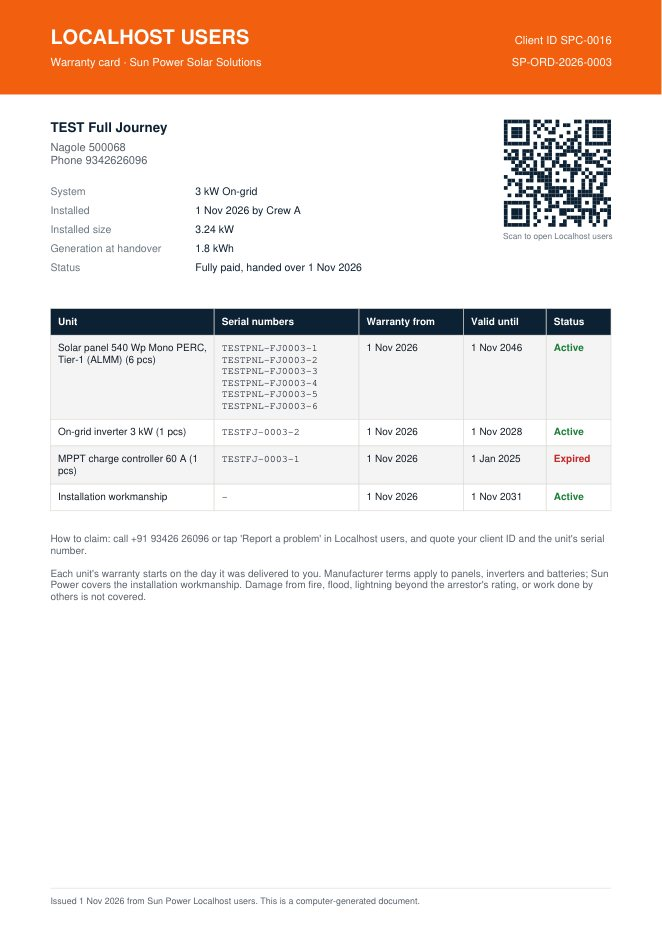 **Warranty card PDF** |

| Technician | Installation form | Customer login |
|---|---|---|
| 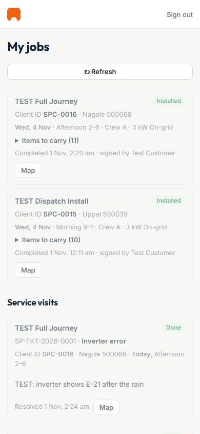 | 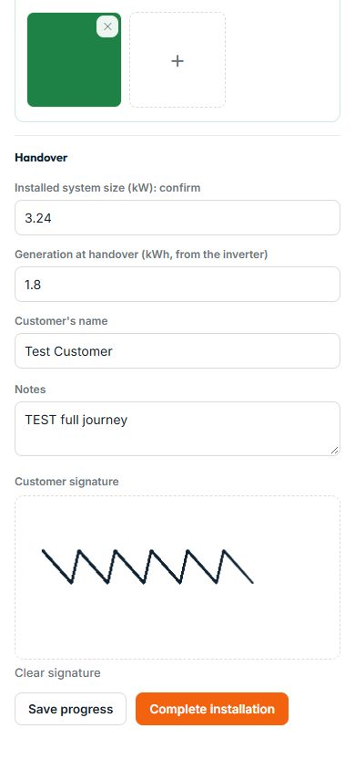 | 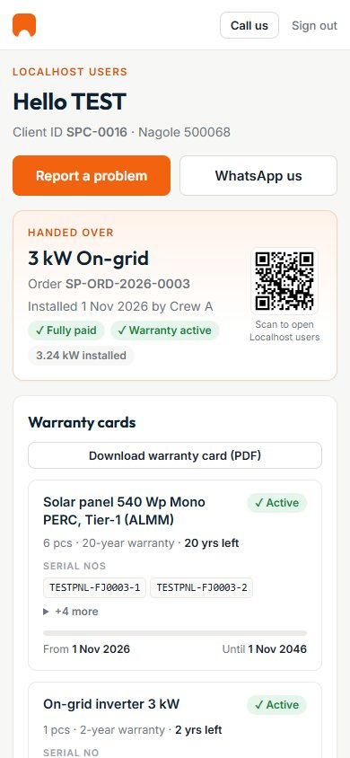 |

---

## Tech stack

| Part | Built with |
|---|---|
| Website, CRM, customer pages | Plain HTML, CSS, JavaScript (no framework, no build step) |
| Database & rules | Supabase Postgres: row-level security, security-definer functions, triggers, `pg_net`, `pgcrypto` |
| Files | Supabase Storage (private buckets: survey, installation and service photos, quotations, receipts, invoices) |
| Server code | Supabase Edge Functions (Deno, `supabase-js`) |
| AI calling | Bolna |
| Call minutes & WhatsApp understanding | Google Gemini |
| WhatsApp | Twilio |
| PDFs & QR codes | jsPDF + AutoTable, qrcode-generator (bundled in `admin/vendor/`) |

---

## Project structure

```
.
├── index.html, styles.css, script.js   Public website with the enquiry form
├── admin/                              CRM (one page, screens per role)
│   ├── admin.js                        Sign-in, roles, leads, AI calls, settings
│   ├── quotes.js, surveys.js           Quotations, kit templates, site surveys
│   ├── orders.js, warehouse.js         Orders, payments, receipts, packing, dispatch
│   ├── schedule.js, scanner.js         Crew calendar, technician app, serial scanner
│   ├── service.js, service-visits.js   Service desk, tickets, technician visits
│   ├── invoices.js, finance.js         GST invoices, job profit, subsidy, team pay
│   ├── products.js, purchases.js       Stock, products, supplier purchases
│   ├── director.js                     Director dashboard and month-end report
│   └── vendor/                         supabase-js, jsPDF, AutoTable, QR code library
├── portal/                             Customer login (Localhost users) and private link page
├── supabase/
│   ├── *.sql                           Database: run in the order below
│   ├── bolna-agent.md                  The AI advisor's prompt and setup
│   └── functions/                      Edge Functions
│       ├── call-lead/                  Places the AI call (deployed as clever-task)
│       ├── bolna-webhook/              Call results + Gemini minutes (deployed as hyper-action)
│       ├── send-whatsapp/              All WhatsApp messages and replies
│       └── customer-portal/            Customer sign-in and their data
├── SETUP-ORDERS.md                     Detailed setup and test checklist per module
├── serve.py                            Local web server for demos
└── docs/screenshots/                   Images used in this README
```

---

## Setup

### 1. Supabase project
Create a project. Then, in **SQL Editor**, run the files in `supabase/` in this order:

```
schema → ai_calls → minutes_meetings → quotes → auto_quotes → surveys → engineer_portal
→ orders → installation → service → director → finance → extras → passport
```

Every file is safe to run again. In `schema.sql`, replace the owner's email with yours before running it.

### 2. Edge Functions
Deploy the four functions with JWT verification **off**. They check access themselves.

```bash
supabase functions deploy send-whatsapp   --no-verify-jwt
supabase functions deploy customer-portal --no-verify-jwt
supabase functions deploy clever-task     --no-verify-jwt   # code in functions/call-lead
supabase functions deploy hyper-action    --no-verify-jwt   # code in functions/bolna-webhook
```

The database calls the functions at `https://<project>.supabase.co/functions/v1/...`. If you use a different
project, replace the project address in the SQL files.

Add these **secrets** (Edge Functions → Secrets). They live only on the server:

| Secret | For |
|---|---|
| `BOLNA_API_KEY`, `BOLNA_AGENT_ID`, `BOLNA_FROM_NUMBER` (optional) | Placing AI calls |
| `BOLNA_WEBHOOK_TOKEN` | Checking call results and internal calls |
| `GEMINI_API_KEY`, `GEMINI_MODEL` (optional) | Call minutes, reading WhatsApp replies |
| `TWILIO_ACCOUNT_SID`, `TWILIO_AUTH_TOKEN`, `TWILIO_WHATSAPP_FROM` (optional) | WhatsApp |
| `TWILIO_QUOTE_CONTENT_SID`, `TWILIO_ASK_CONTENT_SID` (optional) | Approved WhatsApp templates for a live sender |

### 3. Outside services
- **Bolna:** create the agent from `supabase/bolna-agent.md`. Set its webhook to `.../functions/v1/hyper-action?token=<BOLNA_WEBHOOK_TOKEN>`.
- **Twilio:** set the WhatsApp "when a message comes in" URL to `.../functions/v1/send-whatsapp`.

### 4. Browser pages
`admin/admin.js`, `portal/portal.js` and `script.js` contain the project URL and the public **anon** key.
That key is meant to be in the browser; the database rules decide what each person can see.

### 5. Team and settings
- Create each person in **Authentication → Users**, then add them to `public.staff` with their role:
  `owner`, `manager`, `staff`, `engineer`, `warehouse` or `technician`.
- Set up crews, products, cost prices and kit templates in the CRM.
- **Quote settings** holds GST, warranty terms, advance %, UPI and bank details, invoice prefix, technician rates
  and the customer login address.

More detail for every module is in [`SETUP-ORDERS.md`](SETUP-ORDERS.md).

---

## Run it locally

```bash
python serve.py
```

| Page | Address |
|---|---|
| Website | http://localhost:8080/ |
| CRM (all staff) | http://localhost:8080/admin/ |
| Customer login | http://localhost:8080/portal/ |

`serve.py` is the built-in Python server with a larger connection queue. The plain `python -m http.server` sometimes
drops one of the CRM's many script files when they load at once.

---

## Demo walkthrough

About 15 minutes, following one customer. Demo sign-in details are shared separately; they are not kept in this public repository.

1. **Website:** show the enquiry form.
2. **Leads:** open a lead → **AI calls**, to show the real call and Gemini's minutes.
3. **Engineer (phone):** My surveys. **Office:** the lead's *Survey & quote* tab, and **Kit templates**.
4. **Orders:** open a completed order to show payments, serials, delivery, site photos, certificate, tax invoice, profit and subsidy.
5. **Warehouse:** the dispatched orders with serial numbers, vehicle and driver.
6. **Technician (phone):** My jobs and service visits.
7. **Customer login:** warranty cards, installation record, documents, warranty card PDF. In the CRM, open lead → **Localhost users**.
8. **Service:** search a serial number to see "In warranty" or "Expired", then open a ticket.
9. **Director:** switch Today / This week / Month, then **Team** and **Subsidy**.

> A new enquiry from the website form makes the AI advisor really call that phone number.

---

## Security

- **Every rule is enforced in the database** (row-level security and checked functions), not only by the screens.
  - Warehouse can't read customers or invoices.
  - Technicians can't see pay or the dashboard.
  - Engineers can't approve their own surveys.
- **No secrets in the browser.** Bolna, Gemini and Twilio keys and the service key live only in Edge Function secrets.
- **Business rules the database enforces:**
  - dispatch is locked until serials are scanned;
  - no cancellation after dispatch;
  - safety checks come before installation;
  - invoices can't be changed after issue;
  - tickets close only after customer confirmation.
- **Customer logins are separate from staff logins** and can never open the CRM.
  - Passwords are stored only as bcrypt hashes, and sessions as SHA-256 hashes.
  - Five wrong tries lock the login, and only the office can make a new password.
- **The customer's private link** is a long random token; only its SHA-256 fingerprint is stored.
- **WhatsApp messages** from the database are sent at most once per event.
