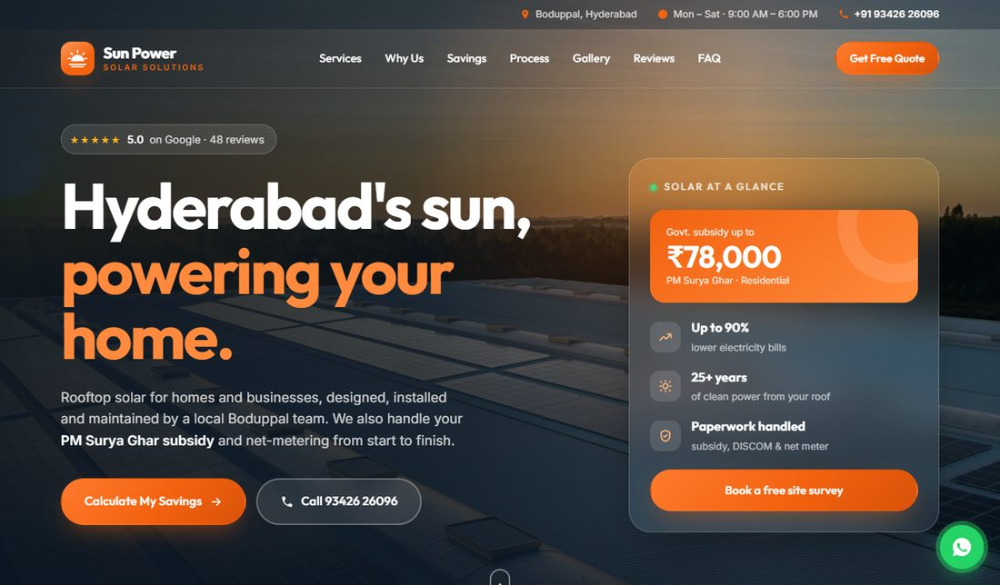
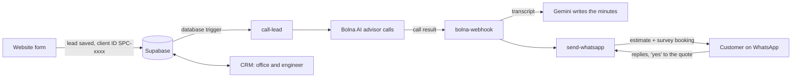
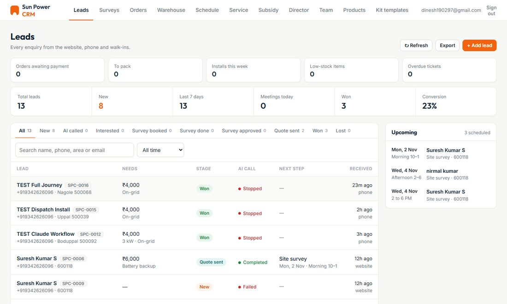
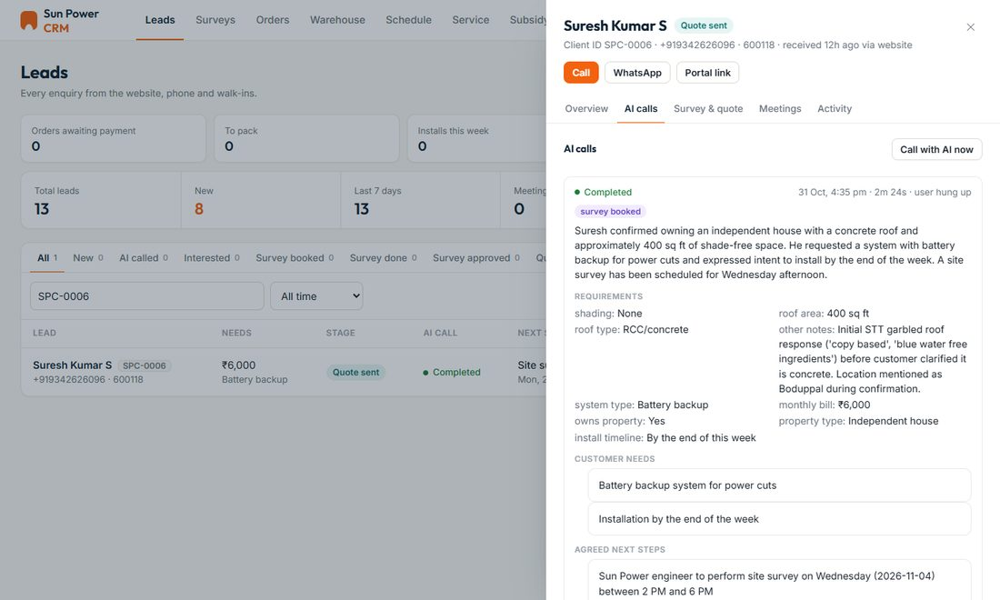
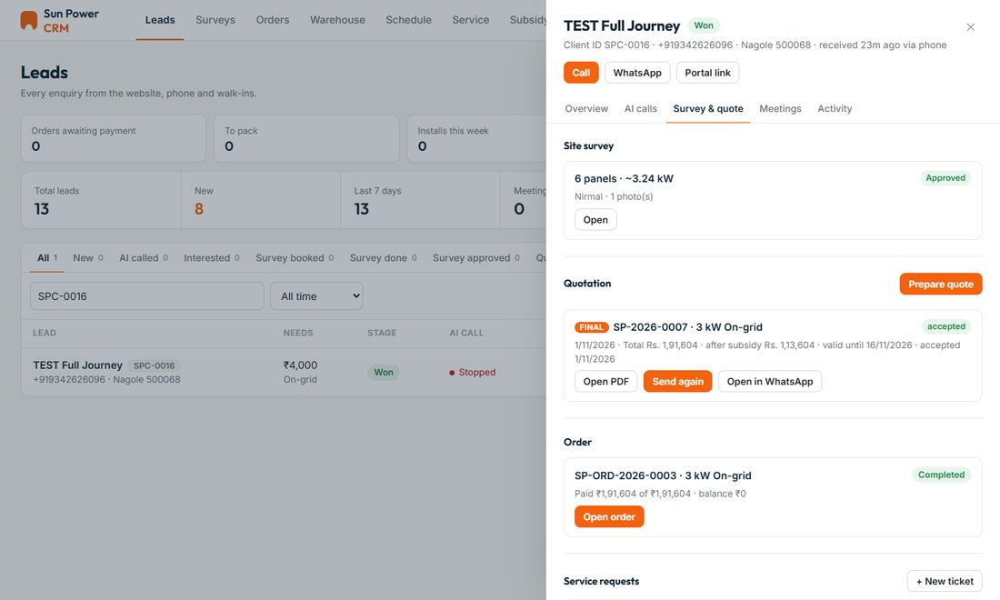
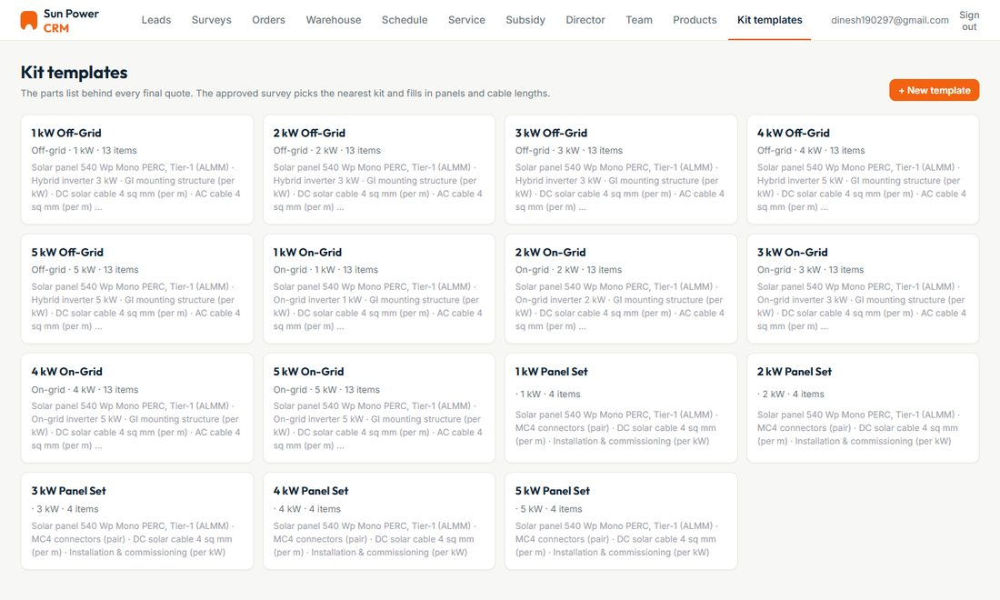
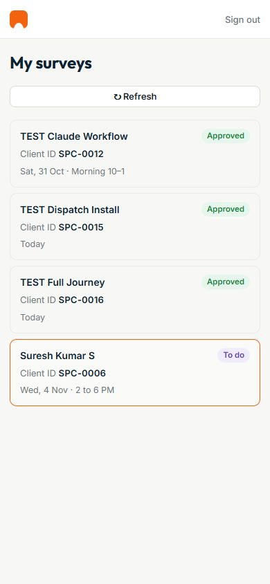

# Solar Installation Management: Module 1, Sales & AI Engagement

Part of the **Sun Power Solar** installation management system. The system has three modules:

| Module | Covers |
|---|---|
| **1. Sales & AI Engagement** (this repo) | **Website, AI calling (Bolna), Gemini call minutes, WhatsApp, leads, site surveys, quotations, and the CRM shell** |
| 2. Operations & Field Service | Orders and payments, warehouse and dispatch, crew schedule, installation, service tickets |
| 3. Reports & Customer | GST invoices, job profit, subsidy, technician pay, director dashboard, customer login with warranty cards |

This module takes a customer **from the first enquiry to an accepted quotation**. Most of the follow-up happens automatically.



---

## How a lead moves



1. **Website enquiry:** the customer leaves their name, phone, area, monthly bill and consent for a call. Optional details are the address, roof and system type. The lead is saved with a client ID.
2. **AI call:** a database trigger asks the **Bolna AI advisor** to call within calling hours (Monday to Saturday, 9 am to 7 pm IST). It talks about the bill, roof, property and timeline, and books a free site survey.
3. **Call minutes:** when the call ends, **Gemini** reads the transcript and writes a summary, requirements, customer needs and agreed next steps. It also books the follow-up meeting.
4. **WhatsApp follow-up:** the system asks for any missing details, or sends an **approximate estimate** with the survey booking. Customer replies are read automatically.
5. **Site survey:** the engineer records the roof on their phone. The office approves it; an engineer can't approve their own.
6. **Final quotation:** built from a **kit template** with GST per item and the PM Surya Ghar subsidy, then sent as a PDF on WhatsApp. A clear "yes" from the customer accepts it and creates the order, which Module 2 picks up.

A lead's stage **only moves forward** (new → AI called → interested → survey booked → survey done → survey approved
→ quote sent → won), so a later call can never undo progress.

---

## What's in this module

**Website** (`index.html`, `styles.css`, `script.js`, `images/`)
- Landing page with services, savings, process, gallery, reviews and FAQ.
- An enquiry form that saves straight to the database, with a WhatsApp fallback if saving fails.

**CRM shell** (`admin/`)
- **One CRM page for every role** (sign-in, navigation and role-based screens), shared by all three modules.
- **Leads:** list with stages, filters and search; lead details with **AI calls**, **Survey & quote**, **Meetings** and the full **Activity** history.
- **Call with AI now**, WhatsApp, call buttons.
- **Quote settings:** GST, warranty terms, subsidy, prices, payment terms.

**AI calling & minutes** (`supabase/functions/call-lead`, `supabase/functions/bolna-webhook`, `supabase/bolna-agent.md`)
- The AI advisor's prompt and setup, placing calls, receiving call results.
- Gemini minutes and the next meeting from each call.

**WhatsApp** (`supabase/functions/send-whatsapp`)
- Estimates, quotations with their PDF, questions for missing details, and reading replies.
- Accepting a final quote on WhatsApp.
- It also sends the order, installation, service and customer-login messages used by Modules 2 and 3.

**Surveys & quotations** (`admin/surveys.js`, `admin/quotes.js`)
- The engineer's mobile survey: roof direction and type, usable area, shading, cable lengths, phase, panel count, photos.
- Manager approval.
- Kit templates for 1–5 kW on-grid, off-grid, hybrid and panel-only sets. Quantities scale with the size and the surveyed cable lengths.
- Estimate and final quotation PDFs.

---

## Screenshots

| Leads | AI call with Gemini minutes |
|---|---|
|  |  |

| Survey & quotation | Kit templates |
|---|---|
|  |  |

| Engineer's phone |
|---|
|  |

---

## Files

```
index.html, styles.css, script.js   Public website and enquiry form
images/                             Website photos
admin/
  index.html, admin.css             CRM page and styles (shared by all modules)
  admin.js                          Sign-in, roles, leads, AI calls, meetings, activity, settings
  quotes.js                         Kit templates, estimates, final quotations, quotation PDFs
  surveys.js                        Engineer's site survey and manager approval
  vendor/                           supabase-js, jsPDF, AutoTable, QR code library
supabase/
  schema.sql                        Leads, staff and roles, activity log, row-level security
  ai_calls.sql                      AI call records and the trigger that starts a call
  minutes_meetings.sql              Call minutes and meetings
  quotes.sql, auto_quotes.sql       Products, kit templates, quotations, automatic estimates
  surveys.sql, engineer_portal.sql  Site surveys and the engineer's screens
  bolna-agent.md                    The AI advisor's prompt and Bolna setup
  functions/
    call-lead/                      Places the AI call (deployed as clever-task)
    bolna-webhook/                  Call results + Gemini minutes (deployed as hyper-action)
    send-whatsapp/                  All WhatsApp messages and replies
serve.py                            Local web server for demos
```

---

## Setup

1. **Database:** in the Supabase SQL Editor, run these in order. Each is safe to run again.
   ```
   schema → ai_calls → minutes_meetings → quotes → auto_quotes → surveys → engineer_portal
   ```
   In `schema.sql`, put your own email as the owner before running it.
2. **Edge Functions:** deploy with JWT verification off (they check access themselves):
   ```bash
   supabase functions deploy clever-task   --no-verify-jwt   # code in functions/call-lead
   supabase functions deploy hyper-action  --no-verify-jwt   # code in functions/bolna-webhook
   supabase functions deploy send-whatsapp --no-verify-jwt
   ```
3. **Secrets** (Edge Functions → Secrets). They live only on the server:

   | Secret | For |
   |---|---|
   | `BOLNA_API_KEY`, `BOLNA_AGENT_ID`, `BOLNA_FROM_NUMBER` (optional) | Placing AI calls |
   | `BOLNA_WEBHOOK_TOKEN` | Checking call results and internal calls |
   | `GEMINI_API_KEY`, `GEMINI_MODEL` (optional) | Call minutes, reading WhatsApp replies |
   | `TWILIO_ACCOUNT_SID`, `TWILIO_AUTH_TOKEN`, `TWILIO_WHATSAPP_FROM` (optional) | WhatsApp |

4. **Bolna:** create the agent from `supabase/bolna-agent.md`, with its webhook set to
   `https://<project>.supabase.co/functions/v1/hyper-action?token=<BOLNA_WEBHOOK_TOKEN>`.
5. **Twilio:** set the WhatsApp "when a message comes in" URL to `https://<project>.supabase.co/functions/v1/send-whatsapp`.
6. **Browser pages:** `script.js` and `admin/admin.js` hold the project URL and its public key. That key is meant to
   be in the browser; the database rules decide what each person can see.
7. **Team:** create each person in Supabase Authentication, then add them to `public.staff` with a role:
   `owner`, `manager`, `staff`, `engineer`, `warehouse` or `technician`.

### Run it locally
```bash
python serve.py
```
Then open the website at http://localhost:8080/ and the CRM at http://localhost:8080/admin/.

> A new enquiry from the website form makes the AI advisor really call that phone number. Use your own number when testing.

## How it connects to the other modules
- The CRM page here also loads the screens of **Module 2** (orders, warehouse, schedule, service) and
  **Module 3** (invoices, finance, director). Add their files to `admin/` to use the full system.
- When a customer accepts a final quotation, an **order** is created. That's where Module 2 takes over.

## Security
- Row-level security on every table: each role sees only what it needs, and the public can only submit the enquiry form.
- No secret keys in the browser: Bolna, Gemini and Twilio keys live only in Edge Function secrets.
- Call results are accepted only with the shared webhook token.
- Twilio's signature is checked on every incoming WhatsApp message.
- AI calls only happen within calling hours, after the customer gives consent on the form.
