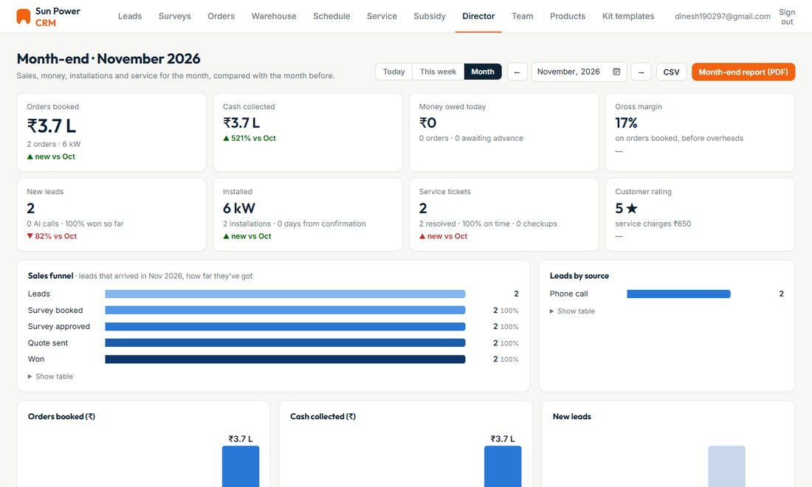
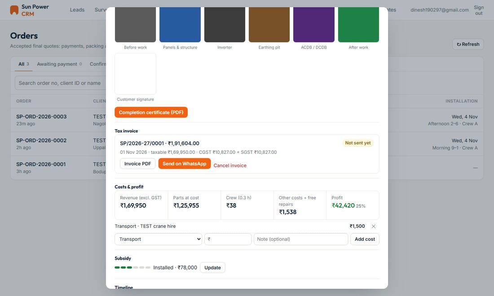
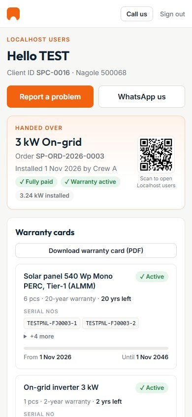
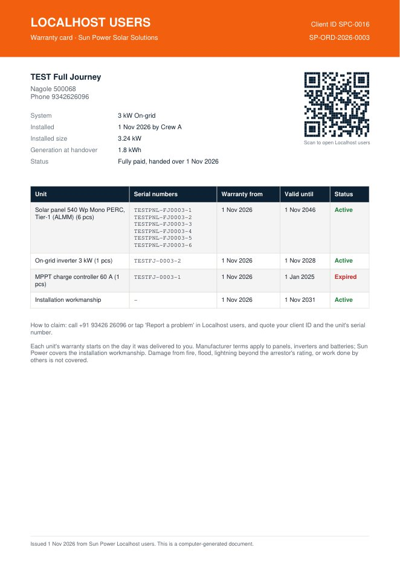

# Solar Installation Management: Module 3, Reports & Customer

Part of the **Sun Power Solar** installation management system. The system has three modules:

| Module | Covers |
|---|---|
| 1. Sales & AI Engagement | Website, AI calling (Bolna), Gemini call minutes, WhatsApp, leads, site surveys, quotations |
| 2. Operations & Field Service | Orders and payments, warehouse and dispatch, crew schedule, installation, service tickets |
| **3. Reports & Customer** (this repo) | **GST invoices, job profit, subsidy, technician pay, director dashboard, customer login with warranty cards** |

This module answers two questions: **how is the business doing?** (for the director and the office) and
**what did I buy and what does it cover?** (for the customer).

---

## What's in this module

### 1. Money: invoices, profit, subsidy, pay
- **GST tax invoices**
  - Numbered per financial year (for example `SP/2026-27/0001`), with CGST + SGST within the state or IGST outside it.
  - An invoice can't be edited once issued; only a manager can cancel it, with a reason.
  - Out-of-warranty repairs get their invoice automatically (parts + visit fee + GST).
- **Profit per job:** revenue (excluding GST) − parts at cost − crew hours − other job costs − free warranty repairs.
- **PM Surya Ghar subsidy tracker:** each application moves through registration → feasibility → installation
  → DISCOM inspection → claim → credited, with its documents.
- **Technician pay:** hours are logged automatically from installations and service visits. Pay per month can be monthly,
  per install, per visit or hourly, and payouts are recorded.

### 2. Director dashboard
- Headline figures for **Today / This week / Month**, each compared with the period before:
  - orders booked, cash collected, money owed, gross margin;
  - new leads, kW installed, service tickets resolved on time, customer rating.
- Sales funnel, leads by source, trends, profit per job and stock purchases.
- **Month-end report (PDF)** and a CSV export. Only the owner and managers can open it.

### 3. Customer login: "Localhost users"
- When an order is **completed** (fully paid), the customer automatically gets a login on WhatsApp: their phone number and a one-time password.
- At first sign-in they set their own password. Then they see:
  - **warranty cards** for every unit (panels, inverter, battery, controller, workmanship), each with its serial numbers, start date, end date, time left and Active/Expired status;
  - the **installation record**: date, crew, installed size, generation at handover, who signed, site photos;
  - **subsidy progress**, payments, tax invoices and receipts;
  - **service requests**, with progress, warranty decision, what was done, and their rating;
  - a **QR code** to their page.
- **Download warranty card (PDF):** one page with every unit, its serials and warranty dates, a QR code and how to claim.
- The office can send a new password from the CRM (lead → *Localhost users*).

---

## Screenshots

| Director dashboard | Order: invoice, costs & profit |
|---|---|
|  |  |

| Customer login | Warranty card PDF |
|---|---|
|  |  |

---

## Files

```
admin/
  invoices.js        GST tax invoices: issue, PDF, send on WhatsApp, mark paid, cancel
  finance.js         Job costs and profit, subsidy tracker, team hours and pay
  director.js        Director dashboard, period switch, month-end PDF report, CSV
portal/
  index.html         Customer page (sign-in and private-link access)
  portal.js          Sign-in, set password, warranty cards, records, service requests, warranty card PDF
  portal.css         Customer page styles
supabase/
  director.sql       month_kpis(), director_dashboard()
  finance.sql        Invoices, invoice numbering, job expenses and profit, subsidy cases, work logs, technician pay
  passport.sql       Customer logins and sessions, sign-in and password functions, login sent on completion
  functions/customer-portal/index.ts
                     Edge Function: customer sign-in, sessions, password change, and the customer's own data
```

---

## How it connects to the other modules

This module builds on the other two and doesn't run on its own:

- **The CRM shell** (`admin/index.html`, `admin/admin.js`, `admin/admin.css`, `admin/vendor/`) and the WhatsApp
  function (`send-whatsapp`) come from **Module 1**. The scripts here plug into that page.
- **Orders, payments, installations and service tickets** come from **Module 2**. Invoices, profit, the dashboard and
  the customer's records are built from that data.
- The customer page uses the CRM's stylesheet and libraries (`../admin/admin.css`, `../admin/vendor/`).

## Setup

1. Run the database files of Modules 1 and 2 first. Then, in the Supabase SQL Editor, run:
   ```
   director.sql → finance.sql → passport.sql
   ```
   Each file is safe to run again.
2. Deploy the Edge Function with JWT verification off (it checks access itself):
   ```bash
   supabase functions deploy customer-portal --no-verify-jwt
   ```
   It uses the project's built-in `SUPABASE_URL` and `SUPABASE_SERVICE_ROLE_KEY`; no extra secrets are needed.
3. Add `invoices.js`, `finance.js` and `director.js` to the CRM page (`admin/index.html`), after the Module 2 scripts.
4. In the CRM's **Quote settings**, set GST details (GSTIN, company state, invoice prefix, HSN/SAC codes), labour cost
   per hour, technician rates, and the **Localhost users address** (the link sent to customers with their login).

## Security
- Invoices, profit, pay and the director dashboard are protected by database rules:
  - only the owner and managers see the dashboard and pay;
  - warehouse staff and technicians can't read invoices.
- Customers are **not** CRM users. They sign in only through the `customer-portal` function, so a customer login can
  never open the CRM.
- Passwords are stored only as bcrypt hashes, and sessions as SHA-256 hashes (30 days).
- Five wrong passwords lock a login for 15 minutes. Only office staff can make a new password, and it signs the customer out everywhere.
- Every request returns only that customer's own data.
